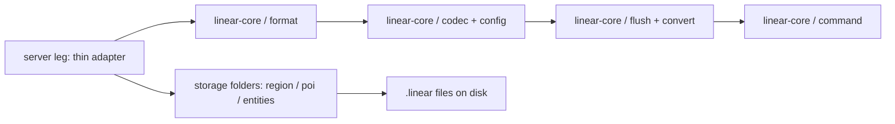
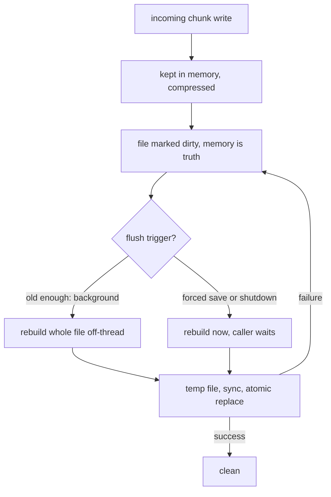

# Architecture

This page covers how Linear stores chunks, when bytes reach disk, and how the shared core relates to each server leg.

## Overview

Each server has a small adapter that delegates to one shared storage core. The core owns the format and all policy. Adapters hold no storage logic, and the core never calls into server code.

The core layers depend in one direction only: the file layout comes first, then compression and settings, then background writing and conversion, and operator commands sit on top.

Every world has three storage folders (region, poi and entities), and each folder has its own write coordinator. All coordinators share one server-wide worker pool.

## On-disk format

One region file holds a 32 by 32 square of chunks, 1024 slots in total.

- Every file starts and ends with the same magic number, C3FF13183CCA9D9A, so a torn or truncated file is easy to reject.
- Files are written as version 2 (V1). Readers accept versions 1 and 2, plus DivineMC's bucketed versions 3 (V2) and 4 (V3), so old and migrated files keep loading after an upgrade. Bucketed files are expanded into the same slot tables on open and are rewritten as version 2 on the next flush. This is a one-way upgrade; the configured `linear.implementation` (default V1) chooses the writer for future files.
- The version-2 body is a single compressed blob holding two things in order: a table of 1024 size-and-timestamp pairs, then the raw chunk payloads concatenated in slot order. An empty slot means the chunk is absent. Versions 3 and 4 instead hold one compressed blob per grid bucket with a per-bucket integrity hash.
- Chunk payloads are opaque: whatever the game hands to storage comes back unchanged on read.
- There are no sidecar files (no `.mcc` files or anything like them). A single chunk larger than 500 megabytes is rejected instead of being spilled elsewhere, the same bound the vanilla game uses.
- The header has a compression-level byte for diagnostics. Readers ignore it, so changing the level changes a setting, not the format.

## Write path

A write first lands only in memory. The durable file rewrite happens later, at flush time.

1. The incoming chunk payload is copied and compressed in memory, outside any lock.
2. Under a short lock, the slot reference is swapped and the file is marked dirty. From here on the in-memory copy is authoritative.
3. The storage layer reports the dirty file to the folder coordinator.
4. At flush time, the file snapshots its tables and clears the dirty mark under the lock. Then, without the lock, it rebuilds the whole region as one compressed stream and replaces the file on disk.
5. The replacement writes a temp file, syncs it to disk and renames it atomically, so a crash leaves either the old file or the new one, never half a file.

A write that races a flush is safe. It either lands in the snapshot being written, or it marks the file dirty again and the next flush picks it up. No acknowledged write is lost.

## Flush coordination

There is one coordinator per storage folder and one shared pool for the whole server.

- The dirty set per coordinator is bounded at 512 files. Duplicates coalesce, so repeated writes to the same file do not grow the set.
- Flushing depends on age. Routine saves only write files whose oldest dirty mark is older than the flush interval (10 seconds by default); younger files wait.
- When the set goes over the bound, the oldest file drains in the background without blocking the game thread, so memory stays bounded while play continues.
- Background drains never block the caller, which carries on as soon as the work is handed off.
- Forced saves and shutdown flush everything regardless of age and wait for all of it to finish, including flushes that another thread started earlier (a heartbeat drain whose rename is still pending): a forced flush joins them before it returns, so after a forced save every earlier edit is renamed into place and its folder synced. The stop loses nothing as long as the flushes finish inside the shutdown settle window (about 30 seconds). At unsafe compression levels they may not finish in time; see `limitations.md`.
- `save-all flush` sits on top of that barrier (core `net.linear.save.SaveAllBarrier`). A leg opens a ticket, registers one task per unit of work (a region section on the forks, the one synchronous save on Paper), and seals it after the last one is scheduled, so it cannot complete early. When every task is done, the ticket (on its own thread, never a region thread) first waits for every chunk I/O task still in flight (the leg's fence host, the same Moonrise task map the coupled save reads), then for staged coupled player saves, then runs the forced coordinator barrier and replaces `<world>/linear-checkpoint/save-all.done` atomically. A wait budget bounds the first two steps (60 s on the forks, 20 s on Horizon on Paper, whose main thread waits). The forced barrier joins every flush already running, including a non-forced drain of a file that an eviction `close()` is flushing outside the coordinator: the drain keeps its in-flight entry until `awaitDurable()` returns. The save-off lease (`SaveOffLease`) and the player file replace (`PlayerFileDurability`, `AtomicFiles`) live in the core too; the legs only hook `setAutoSave`, `PlayerDataStorage.save`, and the stats and advancements writers.
- Coupled save order (`net.linear.save.CoupledSave`, behind `coupled-save.enabled`) sits on the same forced barrier. A leg opens a capture in a region's tick, saves every chunk holder the region owns, and saves the region's players inside it: `PlayerDataStorage.save` and the stats/advancements writers stage their bytes in an in-memory overlay instead of writing. Closing the capture lists every chunk I/O task in flight (Moonrise's task map, `MoonriseRegionFileIO.linear$snapshotInFlight` on the forks, read reflectively on Horizon) and hands it to the `LinearMC-coupled-save` thread, which polls those fences without blocking (a task is done once it left the map after a successful write; a failed write stays FAILED even after the chunk system replaced its task), runs the forced storage flush, and then writes the staged files atomically (each temp forced, one folder fsync per folder per batch). A player leaving a region (cross-region teleport, portal, respawn) runs a departure capture on the source region thread first. A capture whose files were all superseded completes without another barrier. A failed barrier re-lists the fences and retries with backoff; staged files are keyed by path, so a newer capture or a direct write supersedes an older one, and the player load paths read the overlay first. Region threads never wait on that I/O. The legs keep only the adapter (`LinearCoupledSave` on Folia/Canvas, `HorizonCoupledSave`) and the hooks: the periodic player save site, `PlayerList.remove`, `CraftPlayer.saveData`, `ServerPlayer.preChangeDimension` and respawn (departure), `save-all`, the player file read and write paths, and the stop path.
- Background work runs on the single shared worker pool, so a file rewrite that takes several seconds never stalls the game thread. A core heartbeat (`linearmc-flush-heartbeat`, every second, on all legs) submits regions older than `flush-frequency`, so a region file reaches disk at most `flush-frequency` + 1 second (plus the write time) after its first unsaved chunk write, whether or not saves or chunk unloads happen. The crash window for an edit is longer: the server hands a chunk to the region file only at its chunk autosave (`auto-save-interval`), unload or a save; see `limitations.md`.
- Each flush writes `<name>.tmp`, forces it, renames it over the region with an atomic move, then syncs the folder so the rename itself survives a host crash. A filesystem that refuses a folder sync logs one WARN and the flush still succeeds.
- Unloading a world flushes whatever is still dirty in its folders and drops the coordinator registration, so unloaded worlds do not leak coordinators.

## Coupled save and unloads

A chunk unloaded shortly before a coupled-save capture is covered by the capture's fence list: on both forks Moonrise `NewChunkHolder.unloadStage2` calls `saveChunk(chunk, true, ...)`, which registers its chunk I/O task with `MoonriseRegionFileIO.scheduleSave` synchronously on the region thread, before serialization finishes.

## Reading and coexistence

- Reads work in dual mode. Storage looks for the old-style file first, then the Linear file, and opens whichever exists.
- The lookup runs whatever the configured format is, so switching the format setting in either direction is safe.
- The miss cache tracks extensions, so a miss on one extension does not hide a file with the other.
- The format setting only decides what newly created files look like. It never stops the other kind from being read.
- Upgrade and recreate scans see both kinds of file, so world conversion tools find every region.

## Server legs

The server legs under `versions/servers` are thin patches over the game. They adapt the chunk I/O seams, configuration, commands and conversion triggers, and delegate to `linear-core`.

- All call sites share a single mapping from world configuration to storage format, so when formats disagree there is one place to look.
- The game keeps its per-write flush behaviour for the old format. Only Linear hands durability to the coordinator.
- Hunks that are byte-identical across servers live once under `versions/servers/26.3/common`. It is currently empty because the old flush-unlock hunk was folded into Folia `minecraft-0009`. Hunks that are nearly identical but differ in mappings stay per server as thin adapters.
- Dependencies always point inward: legs call the core, never the reverse, which keeps ports and rebases small.

## Concurrency rules

- Each file is guarded by short locks that are never held during disk or compression work, so flushes of different files never block each other.
- The whole server has one shared, bounded worker pool. There is no thread per file and no pool per folder.
- Memory-heavy paths reuse direct buffers end to end instead of allocating on every flush, which keeps garbage-collection pauses down on busy servers.
- Save statistics use only lock-free counters, so measuring never slows saving.
- On every leg, at most one conversion runs per storage folder (core `FolderClaims`). A job claims all of its folders (`region/`, `entities/`, `poi/`) or none of them, and a second `--execute` on a busy folder is rejected with `conversion already running for <folder>` before any job is queued. Folia also runs passes one after another on its single convert worker.
